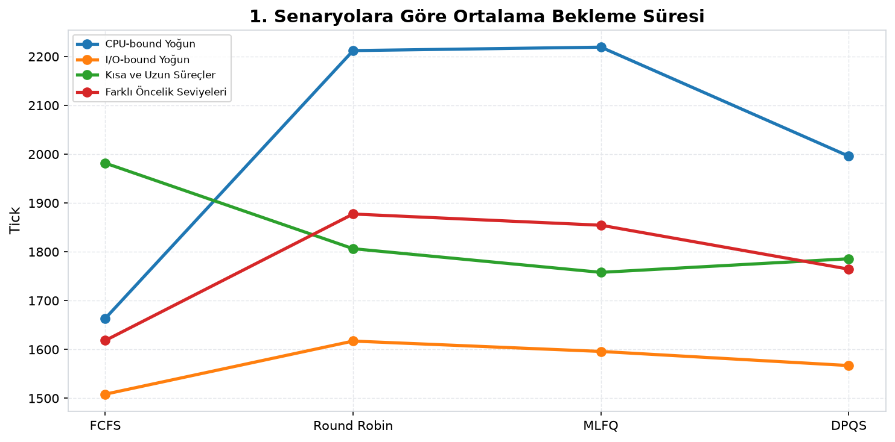
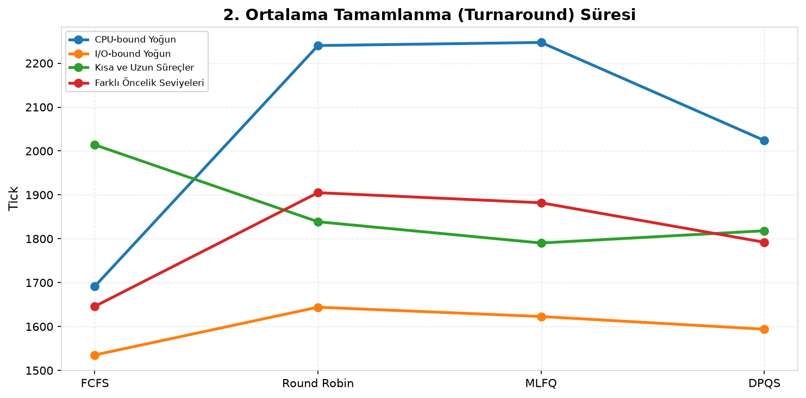
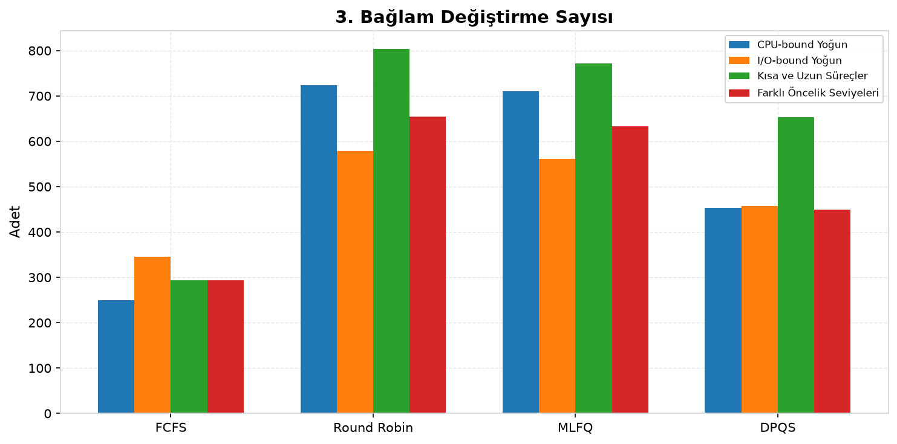
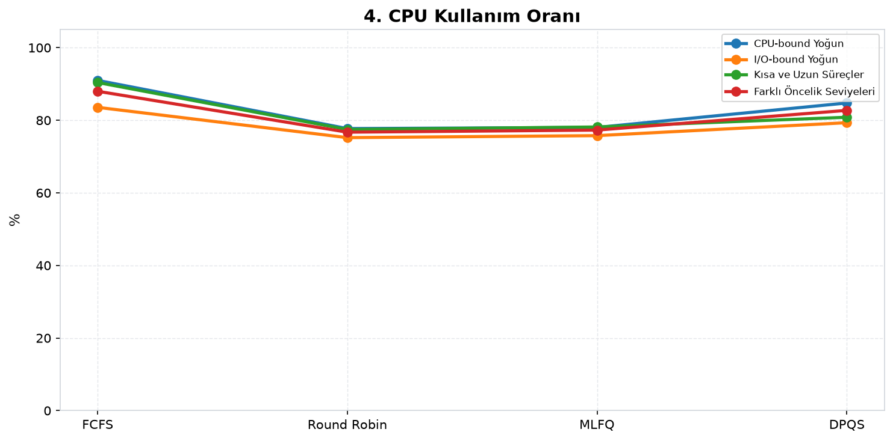
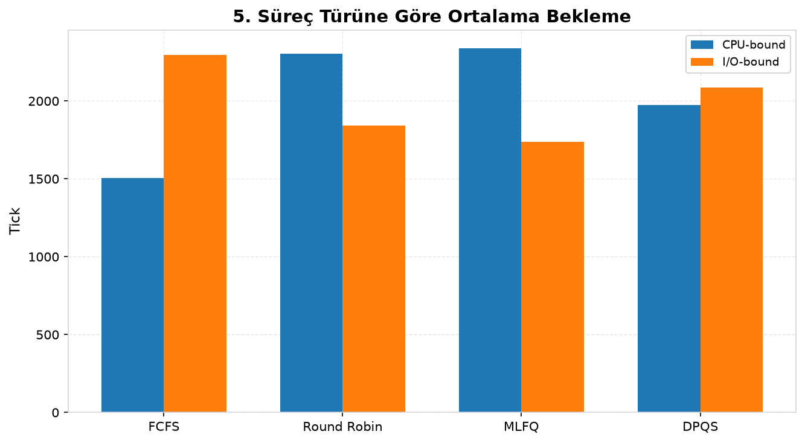
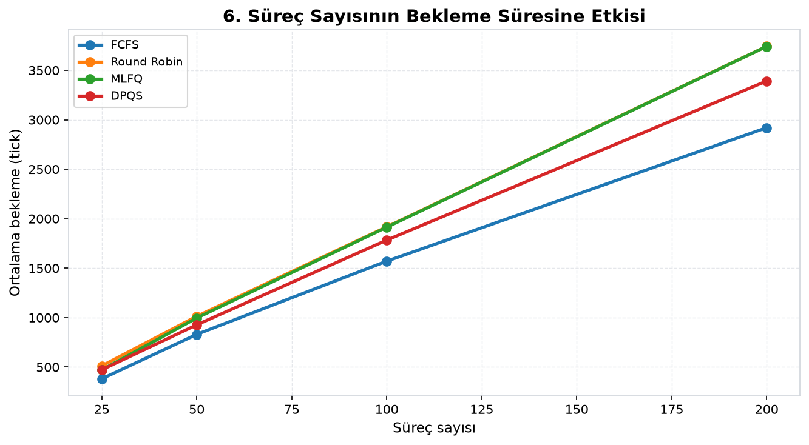
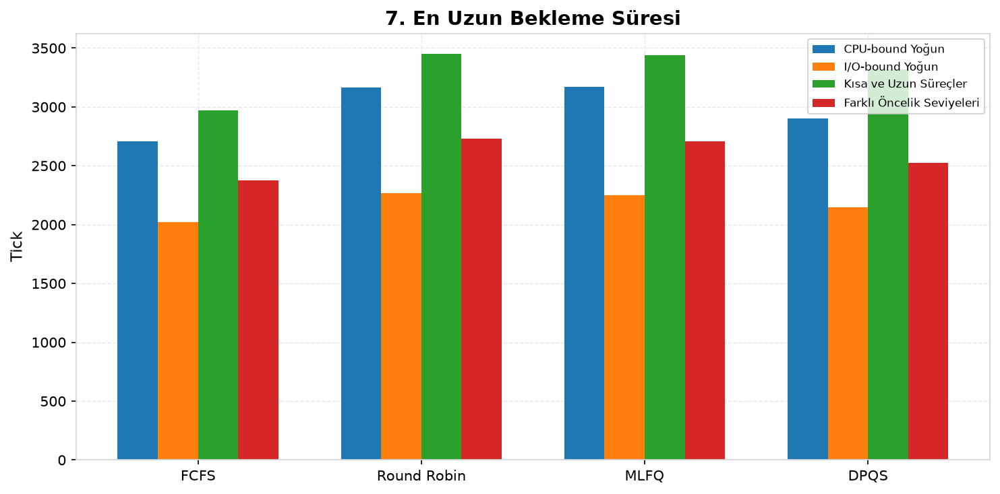

# DPQS – Dinamik Öncelikli Akıllı CPU Kuyruk Yönetimi

FCFS, Round Robin, MLFQ ve DPQS CPU zamanlama algoritmalarını farklı iş yükleri altında karşılaştıran Python tabanlı CPU zamanlama simülasyonu.

## Projenin Amacı

Bu projenin amacı, farklı CPU zamanlama algoritmalarının çeşitli süreç senaryolarında performanslarını incelemek ve karşılaştırmaktır.

Simülasyonda süreçlerin CPU kullanımı, bekleme süreleri, tamamlanma süreleri ve algoritmaların genel performansı analiz edilir. Ayrıca dinamik öncelik kullanan DPQS algoritması, klasik zamanlama algoritmalarıyla karşılaştırılır.

> Proje, CPU zamanlama algoritmalarını simüle eder. Gerçek işletim sistemi süreçlerini yönetmez.

## Kullanılan Algoritmalar

| Algoritma | Açıklama |
|---|---|
| FCFS | Süreçleri geliş sırasına göre çalıştırır. |
| Round Robin (RR) | Süreçlere belirli bir zaman dilimi vererek sırayla çalıştırır. |
| MLFQ | Süreçleri farklı öncelik kuyruklarında yönetir. |
| DPQS | Dinamik öncelik hesaplaması ve bekleme süresine dayalı süreç seçimi kullanır. |

## DPQS Algoritması

DPQS (Dynamic Priority Queue Scheduling), süreçlerin çalışma ve bekleme durumlarını dikkate alan dinamik bir CPU zamanlama yaklaşımıdır.

Süreç seçimi sırasında aşağıdaki faktörler değerlendirilir:

- **Öncelik:** Sürecin başlangıç öncelik değeri.
- **Aging:** Bekleme süresi arttıkça süreç önceliğinin yükselmesi.
- **I/O avantajı:** I/O-bound süreçlere ek puan verilmesi.
- **Kısa süreç avantajı:** CPU süresi az kalan süreçlerin desteklenmesi.
- **İlk yanıt avantajı:** Henüz ilk yanıtını almamış süreçlere bonus verilmesi.
- **Starvation önleme:** Uzun süre kesintisiz bekleyen süreçlerin acil gruba alınması.

DPQS içerisinde 60 tick boyunca kesintisiz bekleyen süreçler acil gruba alınır. Bu grupta en uzun süre bekleyen süreç öncelikli olarak seçilir.

### DPQS Zaman Dilimi (Time Quantum)

| Süreç türü | Zaman dilimi |
|---|---:|
| I/O-bound | 3 tick |
| Diğer süreçler | 6 tick |
| Yoğun yük durumunda | Ek 2 tick, üst sınır 10 tick |

Zaman dilimi, hazır kuyruktaki süreç sayısına göre değişebilir.

## Test Senaryoları

| Senaryo | Açıklama |
|---|---|
| `cpu` | CPU-bound ağırlıklı süreçler |
| `io` | I/O-bound ağırlıklı süreçler |
| `mixed` | Kısa ve uzun süreçlerin birlikte bulunduğu iş yükü |
| `priority` | Farklı öncelik seviyelerine sahip süreçler |
| `all` | Tüm senaryoların çalıştırılması |

## Performans Analizi

Simülasyon sonuçları aşağıdaki kriterler üzerinden incelenir:

- Ortalama bekleme süresi
- Tamamlanma süresi
- Bağlam değiştirme (Context Switch) sayısı
- CPU kullanım oranı
- Süreç türüne göre bekleme süresi
- Süreç sayısına göre ölçeklenebilirlik
- Maksimum bekleme süresi

## Grafikler

Simülasyon sonucunda 7 farklı analiz grafiği oluşturulur.

### 1. Ortalama Bekleme Süresi

Algoritmaların süreçleri ortalama ne kadar süre beklettiğini karşılaştırır.



### 2. Tamamlanma Süresi

Süreçlerin tamamlanma sürelerini algoritmalar arasında karşılaştırır.



### 3. Bağlam Değiştirme

Algoritmaların süreç geçişleri sırasında oluşturduğu bağlam değiştirme miktarını karşılaştırır.



### 4. CPU Kullanımı

Algoritmaların CPU kullanım oranlarını inceler.



### 5. Süreç Türüne Göre Bekleme

Farklı süreç türlerinin bekleme sürelerini karşılaştırır.



### 6. Süreç Sayısına Göre Ölçeklenebilirlik

Süreç sayısı arttığında algoritmaların performans değişimini analiz eder.



### 7. Maksimum Bekleme Süresi

Bir süreç için oluşan maksimum bekleme süresini algoritmalar arasında karşılaştırır.



## Gereksinimler

- Python 3
- NumPy
- Matplotlib

## Kurulum

### Windows (PowerShell)

Proje klasöründe PowerShell açın.

Sanal ortam oluşturun:

```powershell
python -m venv .venv
```

Sanal ortamı etkinleştirin:

```powershell
.\.venv\Scripts\Activate.ps1
```

Gerekli kütüphaneleri yükleyin:

```powershell
python -m pip install -r requirements.txt
```

### macOS (Terminal)

Sanal ortam oluşturun:

```bash
python3 -m venv .venv
```

Sanal ortamı etkinleştirin:

```bash
source .venv/bin/activate
```

Gerekli kütüphaneleri yükleyin:

```bash
python3 -m pip install -r requirements.txt
```

## Projeyi Çalıştırma

### Tüm senaryoları çalıştırma

Windows:

```powershell
python main.py --scenario all
```

macOS:

```bash
python3 main.py --scenario all
```

### Tek bir senaryo çalıştırma

CPU-bound senaryosu:

Windows:
```powershell
python main.py --scenario cpu
```

macOS:
```bash
python3 main.py --scenario cpu
```

I/O-bound senaryosu:

Windows:
```powershell
python main.py --scenario io
```

macOS:
```bash
python3 main.py --scenario io
```

Karma senaryo:

Windows:
```powershell
python main.py --scenario mixed
```

macOS:
```bash
python3 main.py --scenario mixed
```

Öncelik senaryosu:

Windows:
```powershell
python main.py --scenario priority
```

macOS:
```bash
python3 main.py --scenario priority
```

## Çıktılar

Simülasyon tamamlandığında sonuçlar `results/` klasörüne kaydedilir.

- `algorithm_comparison.csv` – Algoritmaların karşılaştırma sonuçları
- `process_details.csv` – Süreç bazlı detaylar
- `terminal_output.txt` – Simülasyon terminal çıktısı
- PNG dosyaları – Performans analiz grafikleri

## Kullanılan Teknolojiler

- Python
- NumPy
- Matplotlib
- CSV

---

**DPQS – CPU zamanlama algoritmalarının performansını simülasyon yoluyla inceleme ve karşılaştırma projesi.**
